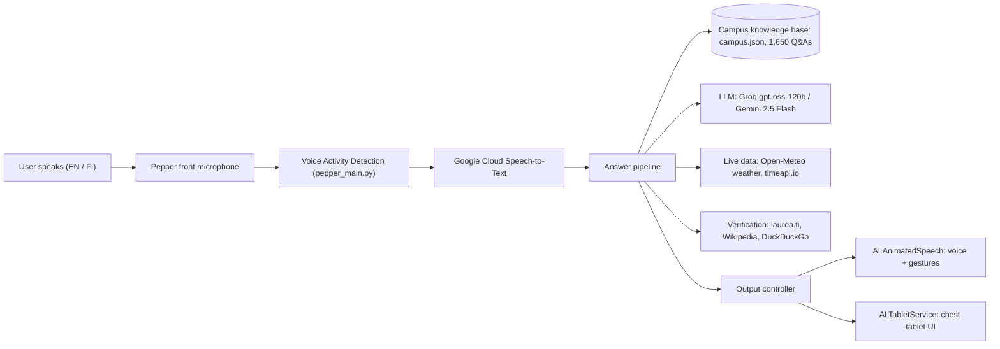
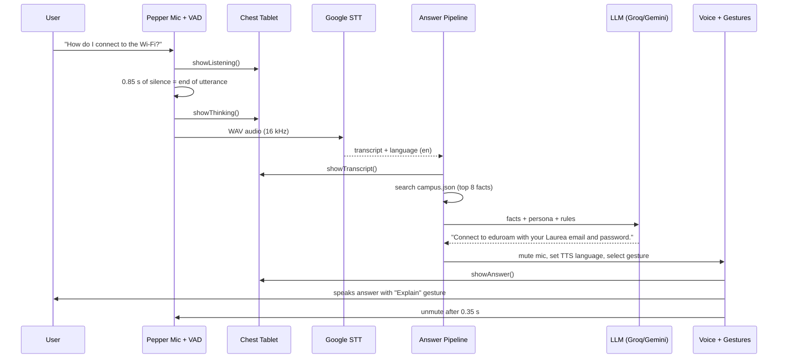
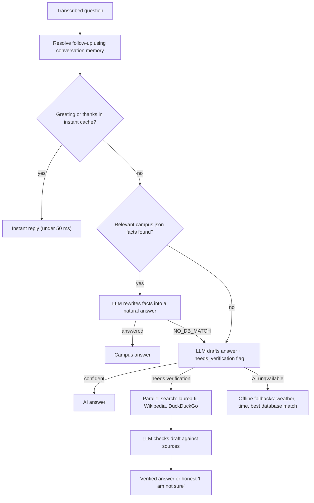

# Laurimate: An AI Campus Assistant on the SoftBank Pepper Robot

**Project report**

| | |
|---|---|
| **Project** | Laurimate – AI campus assistant robot |
| **Institution** | Laurea University of Applied Sciences, Leppävaara campus (Espoo, Finland) |
| **Authors** | Prasiddha Acharya, Rakesh Thakur |

---

## Abstract

Laurimate is a voice-first, bilingual (English and Finnish) campus assistant that runs on the SoftBank Robotics **Pepper** humanoid robot at Laurea's Leppävaara campus. Visitors walk up to the robot and speak naturally; Pepper detects the speech with a custom voice-activity detector, transcribes it with Google Cloud Speech-to-Text, and answers out loud with matching body gestures while showing the question and answer on its chest tablet.

Answers are grounded in a curated knowledge base of **1,650 campus questions and answers** organised into 24 topic sections. A large language model (Groq-hosted `openai/gpt-oss-120b`, with Google Gemini 2.5 Flash as an alternative) rewrites the retrieved facts into short, natural spoken sentences. Questions outside the campus domain (small talk, jokes, general knowledge, the weather, the time) are handled by the AI, which checks the official laurea.fi website, Wikipedia and DuckDuckGo when an answer could be out of date or uncertain. The system remembers the current conversation, so users can ask follow-up questions.

The project also includes a **Kids Entertainment Mode** with 60 dances, animal impressions, games and a photo booth, controlled from the tablet. Deployment scripts install everything on the robot and launch it automatically every time Pepper is powered on, with a watchdog that restarts the assistant if it crashes.

---

## Table of contents

1. [Introduction](#1-introduction)
2. [Hardware and software platform](#2-hardware-and-software-platform)
3. [System architecture](#3-system-architecture)
4. [Implementation](#4-implementation)
5. [Kids Entertainment Mode](#5-kids-entertainment-mode)
6. [Deployment and operations](#6-deployment-and-operations)
7. [Technologies used](#7-technologies-used)
8. [Testing and evaluation](#8-testing-and-evaluation)
9. [Limitations and future work](#9-limitations-and-future-work)
10. [Conclusion](#10-conclusion)

---

## 1. Introduction

### 1.1 Background

New students, international students and visitors often have the same practical questions: how to connect to the Wi-Fi, where the library or canteen is, how to get to the train station, how course enrolment works, or whom to contact in Study Services. These answers exist, but they are spread across the Laurea website, the intranet, the Tuudo app and printed signs. Reception staff answer many of these questions repeatedly.

Laurea has a SoftBank Pepper robot, a 1.2 m humanoid designed for social interaction. Out of the box, Pepper can talk and move, but it has no knowledge of Laurea and only limited speech understanding.

---

## 2. Hardware and software platform

### 2.1 SoftBank Pepper

| Component | Used for |
|---|---|
| Head microphones (front mic, 16 kHz) | Capturing the user's voice |
| Loudspeakers + built-in TTS engine | Speaking answers in English and Finnish |
| Chest tablet (Android, 10.1") | Animated UI with question/answer captions; touch controls in Kids Mode |
| Arms, head, hip, omnidirectional base | Gestures, dances, small movements on stage |
| Eye/shoulder LEDs | Light effects in Kids Mode |
| Head & hand touch sensors | Interactive reactions in Kids Mode |
| Forehead camera | Kids photo booth |
| Wi-Fi | Cloud speech recognition, AI APIs, live data |

### 2.2 NAOqi framework

All robot control uses the **NAOqi Python 2.7 SDK** (`pynaoqi`, included in the repository). The main NAOqi modules we used are:

| NAOqi module | Purpose in Laurimate |
|---|---|
| `ALAudioDevice` | Raw microphone stream (subscribed as a custom `ALModule`) |
| `ALTextToSpeech` | Speech output, language switching (English/Finnish) |
| `ALAnimatedSpeech` | Speech combined with body animation (`^start(gesture)` tags) |
| `ALAnimationPlayer` | Playing specific gesture and dance animations |
| `ALSpeakingMovement` | Contextual body movement while speaking |
| `ALTabletService` | Opening the web UI and calling JavaScript on the tablet |
| `ALMotion` | Waking the robot, walking/turning, collision distances |
| `ALAutonomousLife` | Keeping the robot alive and responsive (`solitary` state) |
| `ALBasicAwareness` | Head tracking / looking at people (Kids Mode) |
| `ALLeds`, `ALAudioPlayer`, `ALPhotoCapture`, `ALMemory` | Lights, music, photos and touch sensors (Kids Mode) |
| `ALConnectionManager` | Wi-Fi configuration tool |

---

## 3. System architecture

### 3.1 High-level overview

The main program, `pepper_main.py` (about 1,470 lines of Python 2.7), runs **directly on the robot**. A laptop is not needed while the robot is running. Pepper connects to cloud services only for speech recognition, AI and live data.

### 3.2 Main software components

| Component | File | Role |
|---|---|---|
| Voice listener | `pepper_main.py` → `SmoothAudioListener` | Streams mic audio, detects start/end of speech, builds a WAV clip |
| Controller | `pepper_main.py` → `LaurimateController` | Main loop: transcribe → answer → speak + show; idle timeout |
| Knowledge base search | `pepper_main.py` → `CampusDatabase` | Keyword/stem/synonym retrieval over `campus.json` |
| AI and verification | `pepper_main.py` → `_answer_core`, `answer_with_ai_then_verify` | Multi-stage answering pipeline |
| Tablet UI | `tablet/index.html` | Animated voice bubble, status pill, captions, particle background |
| Kids Mode | `kids_fun.py`, `tablet/kids.html` | Entertainment controller and touch UI |
| Cloud backend | `functions/index.js` | Firebase Cloud Function `chatWithGemini` (Gemini + campus data) |
| Browser test client | `test.html` | Chat page for testing the AI backend from a PC |
| Boot launcher | `start_on_boot.py` | Auto-start, watchdog, single-instance lock |
| Installer | `deploy_forever.py` | Uploads everything to the robot over SSH/SFTP and configures auto-boot |
| Wi-Fi tool | `set_pepper_wifi.py` | Scans and switches robot + tablet Wi-Fi remotely |

### 3.3 Interaction sequence

---

## 4. Implementation

### 4.1 Hands-free listening: voice activity detection

Pepper's built-in `ALSpeechRecognition` only recognises a fixed vocabulary and does not support Finnish well. We therefore subscribe to the raw audio stream from `ALAudioDevice` and wrote our own **energy-based voice activity detector**:

| Parameter | Value | Reason |
|---|---|---|
| Sample rate / channel | 16 kHz, front microphone | Best quality for speech recognition |
| Pre-roll buffer | 1.0 s ring buffer | The first word is never cut off |
| Start threshold | 120 ms of sustained speech | Ignores clicks and short bumps |
| Speech threshold | `max(2.2 × noise floor, 550)` RMS | Adapts to the room and to Pepper's head fan |
| Noise floor | Exponential moving average (0.96 / 0.04), limited to 150–1200 | Follows changes in background noise |
| End-of-speech silence | 0.85 s | Responsive without cutting people off mid-sentence |
| Minimum speech | 0.35 s | Very short sounds are discarded |
| Maximum recording | 14 s | Safety cut-off |
| Self-hearing protection | Microphone muted while Pepper speaks, +0.35 s settle time | Pepper never transcribes its own voice |

Finished utterances are converted to WAV in memory and put in a thread-safe queue. The controller thread processes them one at a time.

### 4.2 Speech-to-text (English and Finnish)

Each utterance is sent in **one request** to the Google Cloud Speech-to-Text API with:

- `languageCode: en-US` and `alternativeLanguageCodes: [fi-FI]`, so the language is detected automatically and the robot replies in the same language;
- **phrase hints** (boost 20) for campus words that general models often mishear: *Laurea, Leppävaara, Tikkurila, Otaniemi, Hyvinkää, eduroam, Tuudo, Moodle, Pakki, kirjasto, opintotoimisto*, and others;
- a **regular-expression normaliser** applied afterwards that fixes typical errors (e.g. *"laura / loria" → Laurea*, *"leppavara" → Leppävaara*, *"tikurilla" → Tikkurila*, *"edu roam" → eduroam*).

### 4.3 Answer pipeline

The function `_answer_core()` tries a series of strategies and stops at the first one that works:

1. **Instant cache** – greetings, thanks and goodbyes in both languages (*hello, moi, kiitos, näkemiin…*) are answered immediately without network calls.
2. **Campus knowledge base first** – the top 8 relevant Q&As are retrieved (section 4.4) and passed to the LLM together with a block of core campus facts (address, transport, entrances, reception, Wi-Fi, canteen, library, printing, study services, campuses). The LLM may **only** use these facts. If they do not answer the question, it replies `NO_DB_MATCH` and the pipeline moves on.
3. **General AI with self-assessed verification** – the LLM returns JSON: `{answer, needs_verification, search_query}`. Stable knowledge (maths, science, jokes, small talk, the live weather/time) is returned immediately. Facts that change over time (office holders, prices, events) or uncertain Laurea details trigger a **web check**: laurea.fi (WordPress search API + page extraction), Wikipedia and DuckDuckGo are searched **in parallel** (7 s overall timeout). A second LLM call then confirms or corrects the draft. If nothing can be verified, Laurimate says honestly that it is not sure.
4. **Offline fallbacks** – if no AI service is reachable, the robot still answers weather and time questions directly and returns the closest database answer word for word.

### 4.4 Campus knowledge base and retrieval

The knowledge base (`functions/data/campus.json`, ~347 KB) contains **1,650 question–answer pairs in 24 sections**:

| Section | Topic | Q&As |
|---|---|---|
| A | Leppävaara campus basics, access, directions | 40 |
| B | Contacts, Study Services, student affairs | 40 |
| C | Applying & admission basics | 50 |
| D | Accounts, IT support, email, MFA, Wi-Fi | 60 |
| E | Daily studying: schedules, courses, credits, attendance | 70 |
| F | Exams, assessment, retakes | 50 |
| G | Library, printing, study resources | 60 |
| H | Student life, wellbeing, careers | 70 |
| I | Thesis, internship, exchange, graduation | 60 |
| J | Campus facilities in depth | 50 |
| K | Teaching/learning culture | 100 |
| L | Degree structure, credits, policies | 50 |
| M | Exchange & international mobility | 100 |
| N | IT & developer/project needs | 100 |
| O | Wellbeing, legal, crisis support | 20 |
| P | Communication, community, events, admin | 30 |
| Study1 | Study planning, curriculum, HOPS, pacing | 80 |
| Study2 | Course enrolment, implementation rules | 70 |
| Study3 | Assignments, submissions, rubrics, feedback | 100 |
| Study4 | Exams & assessment (deeper) | 90 |
| Study5 | Project-based learning, client projects, LbD | 100 |
| Study6 | Thesis & research (deeper) | 120 |
| Study7 | Internship as studies, RPL/AHOT | 80 |
| Study8 | Studying in English as an immigrant | 60 |
| | **Total** | **1,650** |

**Retrieval algorithm** (`CampusDatabase.get_context`). The retrieval is lightweight so that it runs on Pepper's own processor without a vector database:

1. Normalise the text (lower case; hyphenated words joined, so *"Wi-Fi"* matches spoken *"wifi"*).
2. Remove ~150 English and Finnish stop words (question words, pronouns, filler words, and words that appear everywhere such as *Laurea* or *campus*). Short domain terms like *IT, CV, AI, WC* are kept.
3. Expand with a campus synonym map (e.g. *toilet → restroom, accessible*; *food → restaurant, lunch, menu, Tuudo*; *internet → wifi, eduroam*).
4. Reduce words to simple stems (*libraries → library*, *exams → exam*).
5. Score every Q&A:

$$
\text{score} = 8\,|P \cap Q| + 5\,|S \cap Q| + \sum_{w \in \text{answer}} \begin{cases}3 & w \text{ is an original word}\\ 2 & w \text{ is a synonym}\end{cases}
$$

where *P* = stems of the user's own words, *S* = synonym stems and *Q* = stems of the stored question. Entries with a score of 5 or more are ranked and the **top 8** are passed to the LLM.

### 4.5 Large language model and prompt engineering

- **Primary model:** `openai/gpt-oss-120b` on **Groq** (very low latency, called through `curl` on the robot because the robot's Python 2.7 SSL stack is outdated). `reasoning_effort: low`, `temperature: 0.1`.
- **Alternative:** Google **Gemini 2.5 Flash** (used automatically if Groq fails and a key is configured; also used by the Firebase backend).
- **Persona and rules** in the system prompt:
  - Identity: *"You are Laurimate… created by Rakesh and Prasiddha"*; never claims to be ChatGPT/Gemini.
  - **Under 50 words, 1–2 complete sentences**; for long topics, give the core answer and ask *"Would you like to know more about this?"* / *"Haluatko tietää tästä lisää?"*.
  - No markdown, bullet points or emojis (the text is spoken).
  - Always reply in the user's language.
  - Source trust order: campus database → laurea.fi → Wikipedia/web → the model's own knowledge, and the model's own knowledge only for well-established facts.
  - Never guess Laurea-specific details; say *"I am not sure"* instead of inventing.
  - Friendly, casual tone; no stiff phrases such as *"according to my database"*.
- **Post-processing:** `ensure_complete_sentences()` strips markdown symbols and cuts the answer at the last full sentence within the word limit, so the robot never stops mid-sentence.

### 4.6 Conversation memory and follow-up questions

The last **8 exchanges** are kept in memory. Before answering, short follow-ups (≤ 10 words) are rewritten into standalone questions by the LLM. For example, *"Tell me another one"* after a joke becomes *"Tell me a different joke"*, and *"And where is it?"* is resolved to the place mentioned earlier. The history is also included in the persona prompt so jokes and answers are not repeated. After **60 seconds of inactivity** the session ends, memory is cleared (for privacy and so the next visitor starts fresh), and the tablet returns to the welcome screen.

### 4.7 Live information

- **Weather:** Open-Meteo API for Leppävaara (60.2185 N, 24.8126 E), no API key needed, cached for 10 minutes; WMO weather codes are converted to plain words (*clear, partly cloudy, rainy, snowing…*).
- **Date and time:** Pepper's internal clock turned out to be unreliable (it can be off by years). Laurimate therefore gets the real time from `timeapi.io` (with HTTP `Date` headers from Google/Cloudflare as a backup), **stores the offset from the robot's clock**, and applies EU daylight-saving rules for Helsinki (EET/EEST). The offset is refreshed every 10 minutes.
- Both values are added to every AI prompt, so questions like *"Do I need an umbrella today?"* or *"What day is it?"* are answered correctly.

### 4.8 Embodiment: gestures and speech

- The answer is spoken through `ALAnimatedSpeech` with a gesture chosen from the **question content**:

| Question contains | Gesture set |
|---|---|
| *where, missä, location, room, find* | `ShowTablet` (points at the tablet) |
| *how, why, explain, miten, miksi, kerro* | `Explain_1…8` |
| *thank, great, kiitos, hyvä* | `Enthusiastic` |
| *yes / joo / kyllä*, *no / ei* | `Yes` / `No` nods |
| default | `Explain` |

- A gesture is picked at random from each set so the robot does not look repetitive.
- `ALSpeakingMovement` in *contextual* mode adds natural body movement; `ALAutonomousLife` (*solitary*) keeps breathing and head movements alive between questions.
- TTS language switches automatically between English and Finnish.
- On start-up Pepper waves and says *"Hello! I am Laurimate, your campus assistant. How can I help you?"*.

### 4.9 Tablet user interface

`tablet/index.html` (~1,600 lines of HTML/CSS/JS, Laurea brand colours) runs in Pepper's Android web view. The Python program controls it by calling JavaScript functions through `ALTabletService.executeJS`:

| State | JS function | What the user sees |
|---|---|---|
| Welcome / idle | `showWelcome()` | Laurimate logo, particle background, hint panel with example questions |
| Listening | `showListening()` | Bubble with expanding sound waves, "Listening" status pill |
| Thinking | `showThinking()` | Rotating orbit animation, *"Looking that up for you…"* |
| Transcript | `showTranscript(q)` | *"You asked: …"* while the answer is being prepared |
| Answer | `showAnswer(q, a, source)` | Question and full answer caption; layout adjusts to answer length |
| Not understood | `showNoSpeech()` | Friendly *"Sorry, I couldn't catch that"*, returns to welcome after 4 s |

Showing the answer on screen helps in noisy halls and supports users who are hard of hearing or less confident in spoken English/Finnish. A cache-busting query parameter and a cold-boot retry (after 10, 20 and 35 s) make sure the page loads even when the Android tablet starts slowly.

### 4.10 Cloud backend (Firebase)

`functions/index.js` is a **Firebase Cloud Function (Node.js, v2 HTTPS)** called `chatWithGemini`. It:

- accepts either a text `message` or a base64 WAV `audio` clip;
- builds a system prompt with the same Laurimate persona, the core campus facts and the top matching FAQs from `campus.json`;
- calls **Gemini 2.5 Flash** (the API key is stored in **Firebase Secret Manager**);
- in audio mode, transcribes and answers in a single call and returns JSON `{transcript, language, reply}`.

This backend was the main AI path in earlier versions and is still used by the browser test client (`test.html`) to test and tune answers without the robot. The current on-robot version calls Groq/Gemini directly to reduce latency and remove a network hop.

---

## 5. Kids Entertainment Mode

For open days and school visits we added `kids_fun.py` (~2,450 lines) and a touch interface `tablet/kids.html`.

- **60 actions**, including: disco dance, freeze-dance game, air guitar, kung fu, tai chi, penguin workout, *Head-Shoulders-Knees*, rock-paper-scissors, handshake, high-five, fist bump, Ronaldo *"Siuuu"* and Messi celebrations, birthday song, and 20+ animal impressions (lion, T-rex, elephant, gorilla, farm animals with an *Old MacDonald* show, zoo safari).
- **Photo booth:** Pepper looks at the children, counts down, takes a picture with `ALPhotoCapture` and shows it on the tablet with a *retake* button.
- **Generated music:** energetic dance tracks (EDM, electro-funk, arcade) and animal sounds are **synthesised in Python as WAV files** on the robot, so no copyrighted music is needed.
- **Multi-sensory effects:** disco LED colours, sound effects, small safe stage movements (with reduced but active collision distances).
- **Touch interaction:** touching Pepper's head or hands triggers reactions; the tablet buttons send commands to a small HTTP server on port 8765 running on the robot.
- **Mode switching:** when Kids Mode starts it writes a flag file and pauses the campus assistant; the boot watchdog sees the flag and keeps `pepper_main.py` stopped until the main UI is restored.
- It can be run on the robot itself, from a PC over SSH, or as a background daemon.

---

## 6. Deployment and operations

### 6.1 One-command installation – `deploy_forever.py`

Run from a PC, it connects to Pepper over SSH/SFTP (Paramiko) and:

1. creates the program folder (`/home/nao/Laurimate`) and the tablet app folder;
2. uploads the Python programs, the knowledge base and all tablet files (Windows line endings converted to Unix);
3. registers `start_on_boot.py` in NAOqi's `autoload.ini` under `[program]`;
4. restarts the services and prints the running processes and boot log so the installation can be checked.

### 6.2 Auto-start and self-healing – `start_on_boot.py`

- **Single-instance lock** (binds local port 47831) so only one launcher can run.
- Waits until NAOqi core services (`ALMotion`, `ALTextToSpeech`, `ALAudioDevice`) and `ALTabletService` are ready, plus extra time for the Android tablet browser.
- Starts the Kids Mode touch daemon.
- **Watchdog loop:** if `pepper_main.py` exits for any reason it is restarted after 5 s; all output is written to `laurimate_boot.log`.

Result: the robot only needs to be switched on. Laurimate starts by itself, and no laptop or technician is required.

### 6.3 Network tooling – `set_pepper_wifi.py`

Campus networks change between rooms and events. This tool scans networks and switches **both the robot and its chest tablet** to a new Wi-Fi through `ALConnectionManager` and `ALTabletService`. It falls back to the previous network if the connection fails, and Pepper **says its new IP address out loud** so the team can reconnect.

---

## 7. Technologies used

| Area | Technology |
|---|---|
| Robot | SoftBank Robotics Pepper, NAOqi OS |
| Robot SDK | NAOqi Python 2.7 SDK (`pynaoqi`) |
| Main language | Python 2.7 (on robot), Python 3 (PC tools) |
| Speech recognition | Google Cloud Speech-to-Text (en-US + fi-FI, phrase hints) |
| Speech output | NAOqi `ALTextToSpeech` / `ALAnimatedSpeech` (English and Finnish voices) |
| Large language models | Groq API – `openai/gpt-oss-120b`; Google Gemini API – `gemini-2.5-flash` |
| Knowledge base | JSON (1,650 Q&As) + custom keyword/stem/synonym retrieval |
| Live data | Open-Meteo (weather), timeapi.io (time), laurea.fi WordPress REST API, Wikipedia API, DuckDuckGo Instant Answer API |
| Cloud backend | Google Firebase Cloud Functions (Node.js), Firebase Secret Manager |
| Tablet UI | HTML5, CSS3 animations, JavaScript, HTML5 Canvas |
| Deployment | SSH/SFTP with Paramiko, NAOqi `autoload.ini` |
| Version control | Git + GitHub |

---

## 8. Testing and evaluation

### 8.1 Testing methods used

- **Component testing on the PC:** `test.html` (browser chat client) was used to send questions to the AI backend and check answer quality, length and language before deploying.
- **On-robot testing:** detailed console logs (`[Laurimate] Transcribed… / campus.json matched N facts (top score=…) / AI draft (verify=…) / Verified answer…`) were used to tune VAD thresholds, retrieval scoring and prompts.
- **Robot connectivity test:** `pepper_test.py` checks the basic NAOqi connection and speech.
- **Scenario testing:** campus questions, Finnish questions, follow-up questions, small talk, weather/time, unknown questions, noisy-room behaviour.

### 8.2 Example test scenarios

*Fill in the "Result" column with your own observations from testing on the robot.*

| # | Input (spoken) | Expected behaviour | Result |
|---|---|---|---|
| 1 | "Hello" | Instant greeting, wave gesture | *[ ]* |
| 2 | "How do I connect to the Wi-Fi?" | eduroam + Laurea credentials (campus DB) | *[ ]* |
| 3 | "How far is the train station?" | ~7–8 min walk, ~600 m (campus DB) | *[ ]* |
| 4 | "Missä kirjasto on?" | Finnish answer with Finnish TTS | *[ ]* |
| 5 | "What's the weather like?" | Live Leppävaara weather | *[ ]* |
| 6 | "What time is it?" | Correct Helsinki time | *[ ]* |
| 7 | "Tell me a joke" → "Another one" | Two different jokes (follow-up memory) | *[ ]* |
| 8 | "Who is the president of Finland?" | Verified with web sources | *[ ]* |
| 9 | A Laurea detail not in the database | Honest "I'm not sure" (no invention) | *[ ]* |
| 10 | Background noise / short cough | Ignored, no false trigger | *[ ]* |
| 11 | No interaction for 60 s | Memory cleared, welcome screen | *[ ]* |
| 12 | Robot power cycle | Laurimate starts automatically | *[ ]* |

### 8.3 Measured indicators (to be completed)

| Metric | Value |
|---|---|
| Average response time (end of speech → start of answer) | *[ ] s* |
| Speech recognition accuracy (English / Finnish) | *[ ] % / [ ] %* |
| Correct campus answers out of N test questions | *[ ] / N* |
| User feedback (e.g. 1–5 rating from visitors) | *[ ]* |

---

## 9. Limitations and future work

**Current limitations**

- **Requires internet:** speech recognition and AI answers depend on cloud services. Offline, only greetings, direct database matches and limited fallbacks work.
- **Keyword retrieval:** the stem/synonym search may miss questions phrased very differently from the stored ones; Finnish questions are matched against mostly English Q&As.
- **Knowledge base maintenance:** campus information (opening hours, contacts, menus) changes and must be updated manually in `campus.json`.
- **Privacy:** voice recordings are sent to Google for transcription and the text to the AI provider. Visitors should be informed (e.g. a sign or tablet notice), in line with GDPR.
- **Secrets management:** some API keys and the robot's SSH password are currently written directly in the source code and in the public repository. They should be moved to environment variables or a git-ignored config file (as is already done for the Groq key) and rotated.
- **Single user at a time:** no speaker identification, so group conversations or overlapping speech are not handled.
- **Python 2.7:** required by the NAOqi SDK on Pepper; limits available libraries.

**Future improvements**

1. Semantic (embedding-based) search and a Finnish/Swedish version of the knowledge base.
2. An admin web page for staff to update FAQs without editing code.
3. Wake-word / face detection to start listening only when someone is facing Pepper.
4. Indoor navigation: guiding visitors physically to rooms, or showing campus maps on the tablet.
5. Swedish language support (Laurea is in a bilingual region).
6. Integration with live sources: canteen menu, room bookings, events calendar.
7. Usage analytics (anonymous) to see which questions are most common and improve the database.
8. A formal user study with students and visitors.

---

## 10. Conclusion

Laurimate turns a general-purpose Pepper robot into a **bilingual campus assistant that you can simply walk up to and talk to**, built for Laurea. The project combines robotics (NAOqi audio, motion, gestures, tablet), speech technology (custom voice activity detection, cloud speech recognition with domain tuning), and modern AI (LLMs answering from retrieved campus facts, self-assessed web verification and conversation memory) into a single system that runs on the robot. Accuracy was the priority throughout: campus answers come from a curated 1,650-entry knowledge base, and the robot says when it does not know instead of inventing an answer. Engineering for real use (automatic start, crash recovery, Wi-Fi tooling, tablet cold-boot handling) and the Kids Entertainment Mode mean the robot can run at real campus events, not only as a lab demo.
